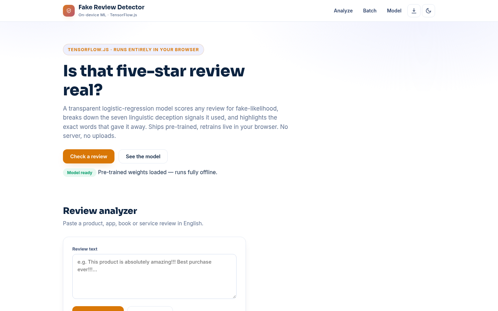
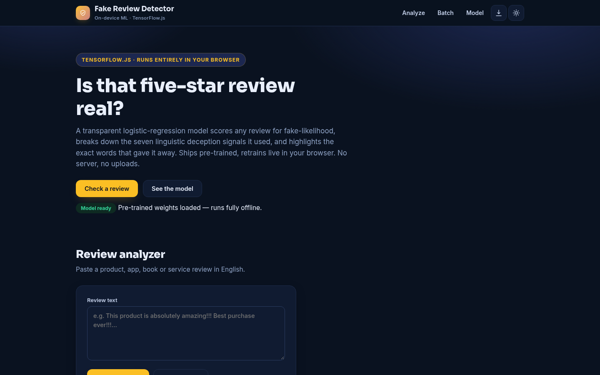
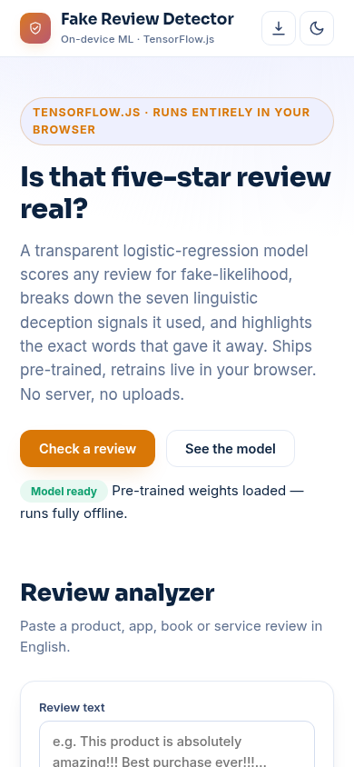

# Fake Review Detector

**[Live demo →](https://akash991833.github.io/fake-review-detector/)** · [Screenshots](#screenshots) · [How it works](#how-it-works) · [Run it yourself](#run-it-yourself)

Is that five-star review real? A transparent logistic-regression model scores any review for fake-likelihood, breaks down the seven linguistic deception signals it used, and highlights the exact words that gave it away. Ships pre-trained, retrains live in your browser. No server, no uploads.

## What it does

- 🔍 **Review analyzer** — paste any product, app, book or service review; get a fake-probability verdict with per-word highlighting (red pushes toward fake, green toward genuine)
- ⭐ **Rating/text mismatch check** — add the star rating to catch all-praise text on a 1★ review
- 📊 **Seven deception signals** — exclamations, caps, hype words, first-person density, specificity, sentence length, repetition — each shown pushing toward fake or genuine
- 📋 **Batch screening** — score a whole listing's reviews at once; near-duplicate reviews (a review-farm fingerprint) are flagged automatically; export as CSV
- 🧠 **Explainable by construction** — occlusion analysis: remove a word, measure the score change; every prediction decomposes into visible word/signal weights
- 🔁 **Retrain in browser** — pre-trained weights load instantly and deterministically; retrain locally any time, nothing leaves your device
- 📱 PWA: installable, offline after first load, light + dark themes, fully responsive

## How it works

1. **Tokenize + stem + negation merge** — "did not last" becomes `not_last`, preserving the negation that flips meaning.
2. **Features** — bag-of-words plus the 7 deception signals.
3. **Model** — logistic regression with L2 → fake probability. A linear model is the right size for a 121-review corpus: every word and signal gets one learned weight, so predictions stay stable and fully explainable.
4. **Metrics are honest** — 5-fold cross-validation over all 121 reviews with out-of-fold predictions: CV accuracy, F1, confusion matrix, vocab and parameter counts are all shown on the Model page.

## Honest limits

Trained on 121 hand-written English reviews (60 fake-style, 61 genuine-style) — it recognizes common fake-review *patterns*, not truth. A well-written fake can pass, and an enthusiastic genuine review can be flagged. It cannot verify purchases. Use the score as a prompt for your own judgment, never as a verdict.

## Stack

Vanilla HTML/CSS/JS + TensorFlow.js (in-browser training/retraining), zero build step, zero servers. Hosted free on GitHub Pages.

## Screenshots

| Desktop (light) | Desktop (dark) | Mobile |
| --- | --- | --- |
|  |  |  |

## Run it yourself

Any static server works:

```bash
python3 -m http.server 8000
# open http://localhost:8000
```

## License

MIT — free to use, free to learn from.
